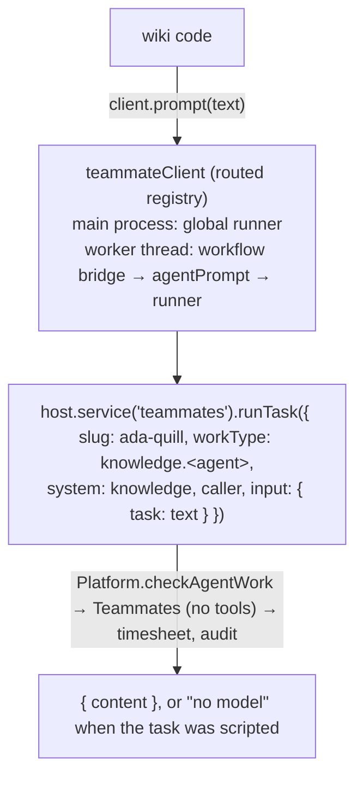

# Phase 24 — Housekeeping: design

> **Status: done (built and reviewed 2026-10-21).** Requirements: `requirements.md`.

## Where it lives

| Place | What |
| --- | --- |
| `nooblyjs-ai-knowledge/src/shared/ai/agentTasks.js` | `useTeammates(run)`, `routedRegistry(registry)`, `routeClient(instance)`, `answersOffline()`; the marker `workflow/.bridge/agent-tasks.json` |
| `…/src/hosted/platform.cjs` | `teammateRunner({ host })`: one `runTask` per prompt, the person from the request (AsyncLocalStorage), "no model" when scripted; the modules get the routed registry |
| `…/src/datasources/lib/aiInstances.js` | The Agents screen's instances come from the routed registry (main process and worker) |
| `…/workflows/system-context/services/folderExpert.js` | The worker-safe expert's client is routed too |
| `…/src/datasources/lib/workflowBridgeServer.js` | `agentPrompt`: a worker's prompt, run by the main process's runner |
| `…/src/wiki/routes/aiChatRoutes.js` | The AI panel answers from the sources when Teammates answers offline |
| `nooblyjs-ai-teammate/index.js` | `storeFor(host, dataDir)`: `host.store` when rooted at `dataDir`, with the cache |
| `…/src/models/fs-store.js` | Re-exports nooblyjs-core's `FsStore`, `StoreError`, `parseMarkdown`, `serializeMarkdown` |
| `nooblyjs-ai-host/package.json` | `nodemon` under `devDependencies` |
| `nooblyjs-ai-host/.claude/audits/mocking-audit.md` | A6 done; A12–A16 |

## How a prompt runs, hosted

The client keeps the provider's shape (`prompt(text, options)` → `{ content, usage, model, provider }`), so no caller
changed. The runner is on `global`, like the wiki's other process-wide state (`global.aiInstances`); the marker file is
how a worker thread, which has module state of its own, knows it is hosted.
