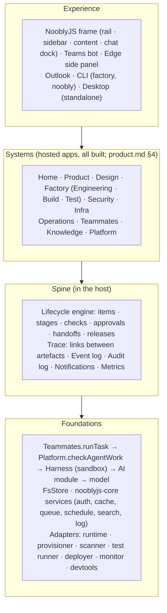
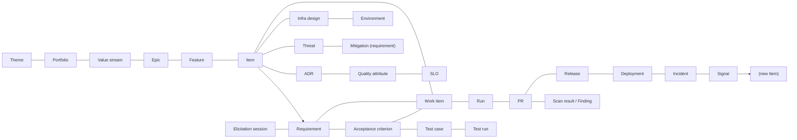
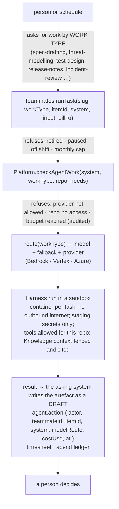
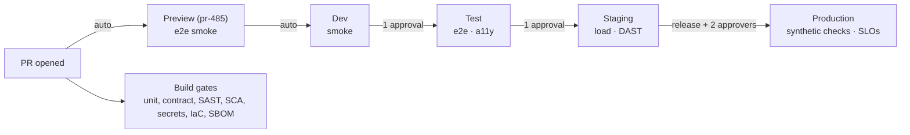

# NooblyJS Software Factory: design

> **Status:** Draft v1 · 2026-10-19, revised 2026-11-17 against the code. How the factory in `product.md` fits together:
> the layers, the item and its trace, events, checks and gates, how an agent's work happens, environments, data
> ownership, and what each system offers the others. `stack.md` has the technology; the detailed contracts that already
> exist stay where they are (`.claude/steering/structure.md` §2a for the hosted-app contract, `tech.md`
> §8b for cross-app services). Decisions taken on 2026-10-19 and 2026-10-20 are written as decided. Where a proposal
> below was built differently, the built name is given and marked **as built**. Anything still open is marked `[CONFIRM]`.

---

## 1. Design principles

1. **One host, many systems.** One process owns the frame, sign-in, approvals, audit and `data/`. Each system is a
   hosted app that registers into it. Systems talk through **services and events**, never by importing each other.
2. **The item is the spine.** Everything the factory produces hangs off an item, and through links off a
   requirement. The lifecycle engine owns where an item is; each system owns its own artefacts.
3. **Events are the record.** Every change emits a named event. Activity, Metrics, notifications, live updates and
   the trace are read from events and files, never from a separate store.
4. **Governance lives in services.** Permissions, guardrails, budgets, agent limits and gate results are checked on
   the server before a write or a dispatch. A hidden button is not a control. Each rule has a test that proves it
   refuses.
5. **One shape for every check.** Readiness checks, quality-attribute gates, standards, policy checks, security
   scans and test results are the same kind of thing (§5). One shape means one way to show, override and measure them.
6. **Adapters at every edge.** Model providers, the container runtime, the provisioner, scanners, the test runner,
   monitoring, Jira, Bitbucket and Microsoft 365 are each one interface with an offline fake. Production picks the
   real adapter by configuration.
7. **Files are the database.** Markdown with front matter, YAML config and daily YAML event streams, written
   atomically through FsStore. Anything derived (indexes, roll-ups, the trace graph) can be deleted and rebuilt.

## 2. Layers



## 3. The lifecycle engine, version 3

The engine in `src/lifecycle/` keeps its model. Version 2 (Phase 16a, 2026-10-19) added Verify,
Release and Operate; version 3 (decided 2026-10-20, Phases 16b–16e, `product.md` §3.2) follows how the teams work.

- **Stages** are `discover, product, design, engineer, build, test, release, operate`. Older keys move once, on
  start, recorded in the audit log: `specify`, `ux`, `ui` → `product`; `architect` → `design`; `verify` and `ship` →
  `test`.
- **Stories** are items of their own (type `story`, linked to their item and to the feature they build) from the Design
  handoff on; each goes through Engineer, Build and Test on its own. A **feature** goes to Release on its own when all
  its stories have passed Test; the item shows where its stories and features are.
- **Handoffs**: the Product handoff (`spec`) → Design; the Design handoff (`design-handoff`, per story) → Engineer;
  the Engineering sign-off (`engineering-signoff`, one approval by an Application Architect and a test lead) → Build,
  before which the Factory starts no run; the **Build approval** (`build-approval`, waiting on an engineer) → Test; the
  **Test approval** (`test-approval`, waiting on a human tester), after which the pull request may merge → Release. Any
  person but a Viewer may give any approval on behalf of someone it waits on, recorded as `by` and `for`; agents
  never; a rule that needs two people (the deploy) needs two different givers. The
  production deploy (`deploy`, two different people, per feature) → Operate; the outcome review → done. The UI handoff
  (`ui-handoff`) and the release candidate (`release-candidate`) are retired.
- **Stage groups for Metrics**: Product (Discover, Product, and history's Specify, UX, UI), Design (and history's
  Architect), Engineer, Build, **Test** (and history's Verify), **Release**, **Operate**, with Ship kept as history.
  The chart's last part is "Build to release".
- **App approvals** (the `infra-design` pattern from Phase 9a: `requestAppApproval` / `closeAppApproval`) are how
  Quality (from the Factory's Test section), Security and Operations ask for decisions. Deciding on Home · Approvals or
  on the app's own screen is the same decision.
- **Stage orchestration** tells the owning system when an item enters its stage (as it tells Product today):
  `design` → the Design app; `engineer` → the Factory (application architecture) and Test (test analysis);
  `test` → Quality (the tester's queue) and Security; `release` and `operate` → Operations.
- **Readiness for the new stages** comes from checks (§5): a pull request can't be given its Test approval until the
  Test stage's checks pass (the required automated tests present and passing), unless a person overrides with a
  reason.

## 4. The trace

The trace is the set of links between artefacts, so any of them can be followed up to the business and down to
production.



- **Links live in the artefact that knows about them**, in its front matter: `links: [{ rel: 'verifies', to:
  'REQ-031-04' }]`. The owner of a record writes its links; nobody writes into another app's files.
- **Lifecycle version 3 adds two links in the chain** (2026-10-20): Requirement ─ **Business requirement** (Design) ─
  **Story** (Design's technical feature, which builds a Feature) ─ Test case and Work item (Engineer) ─ Run ─ PR, with
  the Build and Test approvals on the PR, and a Feature's release once all its stories have passed Test.
- **Ids are global and typed**: `PRD-031`, `REQ-031-04`, `AC-031-04-2`, `ADR-014`, `THR-031-3`, `TST-…`, `RUN-213`,
  `slots-api#482`, `REL-slots-1.0`, `INC-…` (prefixes decided 2026-10-19), and `BR-031-01`, `STORY-031-1`,
  `TC-031-1-1` (a test case) (proposed 2026-10-20). A requirement's id includes its item's number,
  as INF-031 already does.
- **The trace index** is derived: the host reads links from every app's `trace()` service (§8) and from events, and
  keeps `data/trace/index.yaml` as a cache that can be deleted and rebuilt (`npm run trace:rebuild`), the way
  metrics roll-ups are today. No graph database.
- **What it powers**: an item's **Trace** tab (requirement × criterion × test × PR × release, with gaps named in
  words), requirement coverage, orphans ("3 tests verify no requirement"), impact ("these 2 releases shipped code for
  REQ-031-04"), and incident back-links.

## 5. Checks and gates: one shape

Today there are five similar things in four places: readiness checks (lifecycle), quality attributes as gates
(Product → Factory), the standards check (Product), policy checks (Infrastructure) and gate results (Factory).
Security and Quality would add two more. They share one shape:

```yaml
id: chk_…                                                    # given by NooblyJS
key: threat-model-accepted                                   # the app's stable name for it, within the item
kind: readiness | gate | standard | policy | test | scan | review | approval  # where it came from
subject: { item: PRD-031, ref: slots-api#482 }               # what it is about
definedBy: { system: product, ref: QA-031-1 }                # who set the rule
verifiedBy: load-test | contract-tests | axe | sast | person # what proves it
severity: blocking | warning
result: passed | failed | warning | not-run
evidence: { system: quality, ref: TRUN-…, summary: "p95 212 ms at 1,800 rps" }
override: { by: person, reason: "…", at: … }                 # people only
at: …
```

- Each system keeps producing checks in its own data, in this shape (decided 2026-10-19), and reports them with the event
  `check.recorded`. **As built (Phase 16f):** each app maps its checks to the shape in a `checksFor` service; NooblyJS
  gathers them per item, gives each its id and emits `check.recorded` when one is new or changed. The kinds in use
  today are `readiness`, `gate`, `standard`, `policy`, `scan`, `test`, `review` (Security's threat-model acceptance) and
  `approval` (a Build or Test approval, a person's). A person may override one readiness check with a reason; other
  kinds are overridden, or not, by their own app.
- The lifecycle engine reads them for **stage exit**: a stage's required kinds come from `readiness.yaml`, extended
  with the new stages.
- A failing check **offers exactly one agent action** (the existing rule: "Ask Ada to draft rollout"), now also "Ask
  the test agent why this failed" or "Draft a fix as a PR".
- **Models never pass a check.** A check's `verifiedBy` is a deterministic tool or a person.

## 6. How agent work happens (unchanged, now for every stage)



New work types for the new stages go into `model-routes.yaml` (proposed: threat modelling and test design on the
"specs, architecture, review" route; scan triage and release notes on "implementation & tests"; log and alert
summaries on "indexing, triage, clean-up") (decided 2026-10-19). The skills proposed for these stages are
`threat-modelling`, `test-writing`, `accessibility`, `dependency-audit` and `architecture-decision-records`. As of
2026-11-17 the seed defines none of the five as a skill (the names appear in the Security and Design code and in the
steering); each is added as a teammate skill when its drafts need it `[CONFIRM]`.

## 7. Environments, testing and promotion



- **Infrastructure owns environments** (decided in Phase 9a). A build moves right only when that environment's
  tests pass (Infrastructure's rule).
- **Quality owns the tests that run there**: which suites run in which environment kind, and their results. Its
  runner is an adapter (§9) that runs inside a sandbox on the Platform's pool, against the environment's address.
- **Security's dynamic scans** run like a test suite, in Test or Staging only, never in Production (decided 2026-10-19).
- **Production changes only through a release** (Operations), which asks Infrastructure to apply. Infrastructure
  keeps refusing a production apply without a release that two people approved.
- Previews: a `pr.recorded` on a repository that a design serves opens a preview environment for it, and `pr.merged`
  destroys it (built in Phase 21, Infrastructure I8; `src/apps/infrastructure/src/services/previews.js`).

## 8. Who owns what data, and what each system offers

Each app writes only under `data/<mount>/`. Shared records go through the host.

The names below are **as built** (checked 2026-11-17). The first column is what each system owns; the services are the
ones its `index.js` returns to `host.service(name)`; the events are the ones it emits, with the Activity sentence
written by its `event-words` or `summary` code.

| System | Owns (data) | Services it offers (`host.service(name)`, as built) | Events it emits (as built) |
| --- | --- | --- | --- |
| Lifecycle (host) | items, approvals, handoffs, readiness, releases' approvals | `workflows` (`item`, `items`, …); checks gathered per item through each app's `checksFor` | `item.*`, `approval.*`, `handoff.created`, `check.recorded` |
| Trace (host) | `data/trace/index.yaml` (derived; `npm run trace:rebuild`) | the host's `trace` service, which reads every app's `trace` | none: the rebuild prints its differences |
| Product | catalogue, specs, requirements, elicitation sessions, business cases, objectives, feedback notes, ideas | `requirementsFor`, `elicitationFor`, `designInputs`, `architectureFor`, `adrFor`, `businessCases`, `objectives`, `checksFor`, `trace` | `spec.*`, `requirement.accepted`, `elicitation.*`, `business_case.*`, `objective.*`, `idea.*`, `feedback.*`, `portal.*`, `roadmap.*` |
| Design | business requirements, solution architecture, functional analysis, stories, design handoffs | `designFor`, `items`, `nfrCatalogue`, `acceptRequirement`, `readinessFacts`, `trace` | `design.*` (requirements, stories, systems, interfaces, features, criteria, handed off) |
| Factory (Engineer and Build) | runs, gates, PRs, application architecture | `checksFor`, `trace` | `run.finished`, `pr.recorded`, `pr.opened`, `pr.merged`, `architecture.*`, `adr.*`, `scan.finished` |
| **Quality** (the Factory's Test section) | test analysis (test cases), test runs, defects, environment runs | `readinessFacts`, `casesFor`, `testRuns`, `coverage`, `coverageOf`, `gaps`, `defects`, `raiseDefect`, `runEnvironment`, `environmentRuns`, `summaryFor`, `stories`, `recordGates`, `recordRequired`, `trace` | `quality.analysis_drafted`, `quality.case_changed`, `quality.case_ready`, `test_run.recorded`, `defect.raised`, `story.passed_test` |
| **Security** | threat models, findings, risk acceptances, scans, SBOM, policies | `threatModelFor`, `draftThreatModel`, `findingsFor`, `riskFor`, `sbomFor`, `scanChange`, `scanEnvironment`, `acceptRisk`, `checksFor`, `trace` | `threat_model.drafted`, `threat_model.accepted`, `finding.opened` / `closed` / `reopened` / `fix_requested`, `risk.accepted` / `expired`, `scan.finished` |
| Infrastructure | designs, environments, provisioning, drift, cost | `cloudByItem`, `monthlyCostFor`, `environment`, `deployRelease`, `rollbackRelease`, `releaseCandidate`, `recordTests`, `checksFor`, `trace` | `environment.*`, `drift.*`, `infra_design.*` |
| **Operations** | releases, deployments, SLOs, incidents, post-incident reviews, outcome reviews | `releases`, `releaseFor`, `decideApproval`, `slosFor`, `incidents`, `outcomeReviews`, `measure` | `release.*`, `feature.deployed` / `feature.in_release`, `slo.created` / `slo.alert`, `incident.*`, `outcome_review.*`, `signal.raised` |
| Knowledge | as today | as today | as today. **Not yet:** writing accepted ADRs, threat models and post-incident reviews back as pages (proposed 2026-10-19) |

Every new service is a shared change: it goes into the host `tech.md` §8b table in the same change as its code.

## 9. Adapters (new)

All follow the provisioner's pattern: one interface in `src/<kind>/`, a `mock` default that plays the seed story on
`host.clock`, a real adapter chosen by configuration and refused without credentials, and no tool or cloud SDK called
from a route or service.

Built as follows (checked 2026-11-17). Each is chosen by an environment variable; only `mock` is accepted, and any other
name is refused at start.

| Adapter | Owner | Interface, as built | Mock plays | Chosen by |
| --- | --- | --- | --- | --- |
| Scanner | Security (Build scans run as Factory gates through it) | `scan(kind, target, policies)` for `secrets, sast, sca, licence, iac, image, dast, sbom` (`src/scanners/`) | findings for the web and storefront repositories of the seed, in the kinds the mock knows | `SECURITY_SCANNER` |
| Test runner | Quality (`src/apps/factory/quality/src/runners/`) | `run(suite, input)` for `e2e`, `e2e-smoke`, `integration`, `load`, `accessibility`, `resilience` | the environment's baseline of e2e journeys, a measured p95 for `load` against the item's target, and passing `accessibility` and `resilience` | `TEST_RUNNER` |
| Deployer | Operations (`src/deployers/`), through Infrastructure | `deploy(release, { percent, by })`, `rollback(release, { reason, by })` | a staged rollout on the clock | `OPERATIONS_DEPLOYER` |
| Monitor | Operations (`src/monitors/`) | `burn(sloId, minutes)`, `burned(sloId)`, `measure(goal)` | an SLO burn and one incident for the story | `OPERATIONS_MONITOR` |

The real scanners and runners execute **inside a harness sandbox** on the repository's base image, so the "no outbound
internet" and "no production secrets" rules hold for them as for agents. The mocks run in the host's process, which is
allowed because they call no tool. A dynamic scan is the one exception that
must reach an environment: it is allowed to reach only that environment's address (decided 2026-10-19).

## 10. The loop back (Learn)

- Operations raises a **signal** into Product for an incident (built in Phase 23, `signal.raised`), with its source,
  linked to the release and item. An SLO breach, a failed synthetic check and a failed outcome review are the same kind
  of signal and are **not yet** raised; the SLO and outcome-review services do not call Product.
- Knowledge sources (Zendesk, app reviews, logs) keep feeding signals as today.
- The outcome review reads the spec's goals (`measure / today / target`), asks Monitoring for the measure's current
  value where it can, and asks a person for the rest. Its result is an event that Metrics counts.

## 11. Screens (where the new work shows)

Kept short: each new app specifies its own screens in its `product.md` when its phase starts.

| Where | What is added |
| --- | --- |
| Home · Overview | The line shows eight stages; a **Learn** arrow back to Discover with this month's signals from production |
| Home · Approvals | Design handoff, Engineering sign-off, Build approval, Test approval, threat model, risk acceptance, production deploy, outcome review |
| Item page | **Trace** tab; **Checks** panel (all kinds, one list, with overrides) |
| For you | Business owner, Business analyst, QA, Security engineer, SRE homes |
| Product · Specs | **Elicitation**: stakeholders, sessions, candidate requirements, questions |
| Factory · Design | Business requirements, Solution architecture (feature landscape, impacted systems, NFRs), Functional analysis (interface and technical requirements), Stories, Handoff |
| Factory · Engineering | Application architecture (from the code), Test analysis, Engineering sign-off |
| Factory · Test (Quality) | Test approvals (pull requests waiting on a tester), Coverage, Test runs (by environment), Defects |
| Security | Threat models, Findings (by age against fix-by), Risk register, Policies |
| Operations | Releases, Deployments, SLOs, Incidents, Reviews |
| Metrics | DORA tiles, requirement coverage, findings past fix-by, idea → outcome |

## 12. Risks in this design

| Risk | Mitigation |
| --- | --- |
| Two new apps and a new Factory section add weight to one process | They are hosted, small, file-backed and lazy; the host's failure isolation (checklist steps 8–10) already keeps one bad app from taking down the rest |
| The trace index drifts from the artefacts | It is derived only; `trace:rebuild` and a reconcile test, like `metrics:reconcile` |
| One check shape forces changes into four existing apps | Adopt it at the edge first: each app maps its own records to the shape in its `checksFor` service, then migrates storage later if worth it |
| Scanners and test tools need outbound access (rules, databases) | Their images are built with what they need; registries and rule feeds are allow-listed like package registries |
| Stage split breaks existing metrics history | `ship` maps to `release`; the "Build & ship" history is kept under its old name and labelled |
